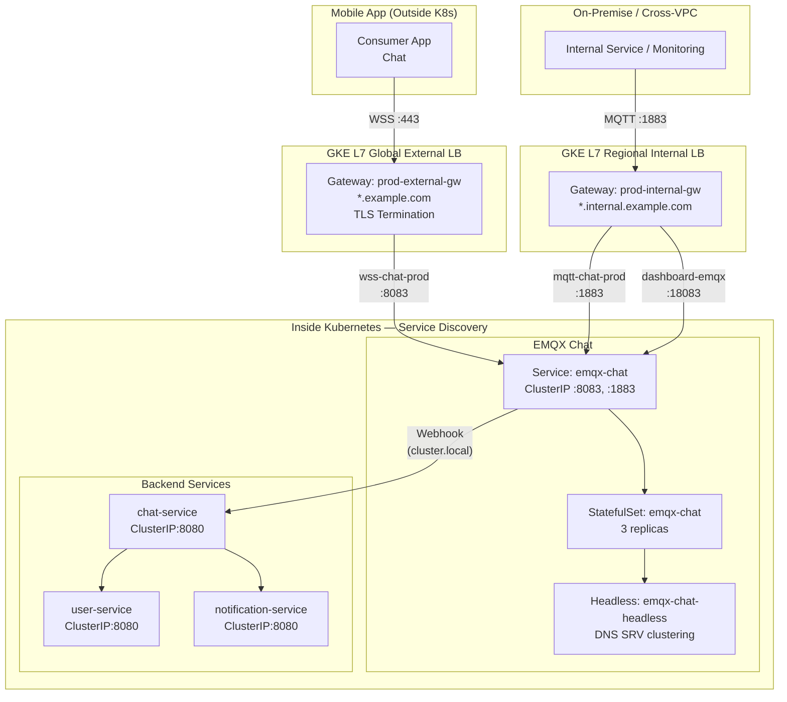

# CFP Submission — KCD Indonesia 2026

> **Event:** Kubernetes Community Days Indonesia 2026
> **Date:** October 24, 2026 — Bandung, Indonesia
> **Track:** Service Mesh & Networking
> **Format:** Lightning Talk (10 min)
> **Status:** Accepted — preparation draft

---

## Title

**Architecting a Real-Time Chat Platform on GKE Using Kubernetes Gateway API and EMQX**

## Subtitle

Scaling WebSocket chat with dual gateways, EMQX MQTT, and webhook authorization.

---

## Speaker Information

| Field | Value |
|---|---|
| **Name** | Ahmad Nurhidayat |
| **Role** | Cloud DevOps Engineer at a leading consumer platform in Indonesia |
| **Bio** | A highly driven Information Technology graduate from Universitas Jenderal Achmad Yani Yogyakarta, specializing in Cloud DevOps Engineering. Experienced in architecting and managing cloud infrastructure, containerized environments, and CI/CD pipelines with a strong focus on reliability, scalability, and performance optimization. Proficient in leveraging leading technologies including Google Cloud Platform (GCP), Kubernetes, Terraform, and Grafana Stack. Currently working as a Cloud DevOps Engineer at a leading consumer platform in Indonesia, where I design and operate production GKE clusters serving millions of active users, building real-time networking infrastructure with Kubernetes Gateway API — a dual-gateway architecture powering in-app chat via EMQX MQTT brokers and WebSocket connections. |
| **Twitter / LinkedIn** | [Your handles] |
| **Location** | [Your city — mention if outside Jakarta for travel support] |

---

## Talk Summary (2-3 sentences)

Real-time chat looks simple until every message must reach the right user over a long-lived connection. This talk explains how a national-scale consumer platform runs in-app chat on production GKE using Kubernetes Gateway API with a dual-gateway pattern (external WSS + internal MQTT) — covering WebSocket timeouts, strict topic ACLs, webhook-based authorization, and canary deployment.

### Sessionize Abstract (max 900 chars)

> **Copy-paste ready:**

Real-time chat is simple until every message must reach the right user over a long-lived connection. This talk shows how we run in-app chat on GKE using Kubernetes Gateway API with a dual-gateway architecture — an external gateway for mobile WSS and an internal gateway for cross-VPC MQTT. Inside the cluster, native service discovery handles pod-to-pod routing.

We run a 3-replica EMQX cluster for chat: webhook-authenticated connections, strict topic ACLs, and HTTP-based channel authorization through an external chat service. GKE-native CRDs (GCPBackendPolicy, HealthCheckPolicy) provide 120-second timeouts for WebSockets and health checks.

Key takeaways: role separation between platform and app teams, explicit timeouts for long-lived connections, canary deployment via native weight splitting, and when to use Gateway API versus service discovery.

### Sessionize Description

> **Copy-paste ready:**

This session presents a production-proven approach to real-time in-app chat on Google Kubernetes Engine using Kubernetes Gateway API, EMQX MQTT, and GKE-native load balancing. We built a dual-gateway architecture that routes public WebSocket traffic through an external gateway and cross-VPC MQTT through an internal gateway, while native service discovery handles pod-to-pod traffic. A 3-replica EMQX cluster provides webhook authentication, strict topic ACLs, and per-channel authorization, keeping chat delivery reliable at national scale.

We'll cover the full stack: Gateway API resources, GKE backend and health-check policies for 120-second WebSocket timeouts, EMQX clustering with headless services and DNS SRV, and webhook integration with the chat service. The session includes production lessons on long-lived connection timeouts, reconnect behavior, canary rollouts, and monitoring connection health and webhook latency — the patterns we use to keep chat stable during change.

---

## Abstract (Full Description)

### Problem

A national-scale consumer platform runs real-time in-app chat for millions of active users. Every message depends on a long-lived WebSocket connection being routed to the correct EMQX MQTT broker, authorized for the correct channel, and delivered to the right recipient.

Three things make this hard:

1. **Long-lived connections** — WebSockets stay open for hours. Default idle timeouts will cut them unless every layer is tuned deliberately.
2. **Per-channel authorization** — A user may publish to one channel and subscribe to another. Authentication at connect time is not enough; authorization must happen per topic.
3. **Webhook coupling** — The chat service processes messages and enforces access through HTTP webhooks. If that path is slow or unavailable, message delivery degrades.

Before adopting Gateway API, we faced several challenges with Ingress:

- ingress-nginx retired (March 2026) — no more security patches
- WebSocket long-lived connections required difficult timeout tuning in Ingress
- No native support for weight-based or header-based canary deployment
- Difficult to separate concerns between the platform team (gateway config) and app team (routing rules)

### Solution

We adopted Kubernetes Gateway API on GKE with a **dual-gateway** architecture:

**External Gateway** (`gke-l7-global-external-managed`):

- Serves public traffic to `*.example.com`
- TLS termination at the load balancer
- Routes `wss-chat-prod.example.com` to the EMQX chat service

**Internal Gateway** (`gke-l7-rilb`):

- Serves internal traffic to `*.internal.example.com`
- Regional Internal Load Balancer
- Handles cross-VPC MQTT and the EMQX monitoring dashboard

**EMQX MQTT Broker** (3-replica StatefulSet):

- Webhook-authenticated WebSocket connections
- Strict topic ACLs: admin-only publish; users subscribe to their own channels
- Webhook integration to an external chat service for message processing and per-channel authorization
- WebSocket exposed via Gateway API on port 8083

**GKE-Native CRDs**:

- `GCPBackendPolicy` — 120-second timeout for WebSocket connections
- `HealthCheckPolicy` — HTTP health check to `/api/v5/status`
- `GCPGatewayPolicy` — links backend policy to service

### Key Takeaways

1. Gateway API is not just an Ingress replacement — it is a role-oriented API that separates concerns between platform and app teams
2. WebSocket routing works without special controller configuration, but timeouts and heartbeats must be explicit at every layer
3. Canary deployment (weight-based and header-based) is a native feature, not an annotation hack
4. The dual-gateway pattern (external + internal) separates public chat traffic from cross-VPC MQTT by trust boundary
5. GKE-native CRDs offer better control compared to generic annotations

### Lessons from Production

1. **Separate gateways by trust boundary, not just hostname.** The external gateway terminates public TLS; the internal gateway is regional and not internet-reachable. The same routing model serves different exposure.
2. **Long-lived connections need explicit timeouts at every layer.** Client heartbeat, backend policy (for example, 120 seconds), and broker session TTL must be aligned. Default idle timeouts will cut WebSockets.
3. **Authentication is not authorization.** The connection webhook proves who connected; the per-channel authorization decides what they may publish to or subscribe to. Keep both, and do not duplicate the policy in the gateway.
4. **Use headless services for StatefulSet clustering.** EMQX nodes find each other through DNS SRV records; consumers use ClusterIP. Mixing the two causes flapping.
5. **Treat the webhook as part of the delivery path.** Measure its latency and error rate. A slow chat service becomes slow message delivery, even when the broker is healthy.
6. **Canary with weights and headers, not parallel infrastructure.** Gateway API makes a 1% → 100% rollout a route change.
7. **Monitor connections, not just requests.** Track active connections, handshake failures, broker saturation, publish/subscribe rates, and webhook latency alongside HTTP 5xx.

### When to Use What

| Need | Use | Why |
|---|---|---|
| HTTP/HTTPS routing, TLS, host/path matching | Gateway API (or Ingress) | Standard L7 routing |
| Long-lived WebSocket / MQTT | Gateway API + backend timeout policy | Explicit timeout control |
| Canary / blue-green | HTTPRoute weights + header matching | Native traffic splitting |
| Pod-to-pod inside the cluster | Service discovery (ClusterIP / Headless) | No gateway hop |
| Service-to-service auth, mTLS, retries | Service mesh | Policy at the mesh layer |
| Per-user chat authorization | Broker ACL + webhook | Authorization close to the message path |

### Adoption Checklist

- [ ] Choose one GatewayClass per exposure (external vs internal)
- [ ] Define ownership: platform team owns Gateway, app teams own HTTPRoute
- [ ] Set backend timeout policy for long-lived connections
- [ ] Align client heartbeat, gateway timeout, and broker session TTL
- [ ] Use headless services for stateful brokers
- [ ] Measure webhook latency and error rate as part of delivery health
- [ ] Add a canary route with weights before rollout
- [ ] Monitor connection counts and handshake failures

---

## Technical Details

### Architecture

### Three Communication Layers

| Layer | Gateway | Consumer | Protocol | DNS |
|---|---|---|---|---|
| **External** | `gke-l7-global-external-managed` | Mobile App | WSS :443 | `wss-chat-prod.example.com` |
| **Internal** | `gke-l7-rilb` | On-premise, cross-VPC, monitoring | MQTT :1883, HTTP :18083 | `mqtt-chat-prod.internal.example.com` |
| **Inside K8s** | None — Service Discovery | Pod-to-pod | ClusterIP / Headless | `emqx-chat.infrastructure.svc.cluster.local` |

**Key insight:** Gateway API handles traffic entering or leaving the cluster. Inside the cluster, native Kubernetes service discovery (ClusterIP for singletons, Headless for StatefulSet clustering) handles pod-to-pod communication.

### EMQX Configuration Highlights

| Setting | Chat System |
|---|---|
| Auth | HTTP webhook at connect + per-channel authorization |
| ACL | Strict deny-all; admin-only publish; users subscribe to their own channels |
| WebSocket | Port 8083, path `/mqtt` |
| Session TTL | 24 hours |
| Connection limit | 2M |
| GCPBackendPolicy timeout | 120s |
| Health check | HTTP `/api/v5/status` |

### Gateway API Resources Used

| Resource | Purpose |
|---|---|
| `GatewayClass` | `gke-l7-global-external-managed` (external), `gke-l7-rilb` (internal) |
| `Gateway` | Wildcard `*.example.com`, TLS termination, listeners |
| `HTTPRoute` | Per-service hostname routing, path matching |
| `GCPBackendPolicy` | Timeout, security policy, rate limiting |
| `HealthCheckPolicy` | HTTP health checks for EMQX |
| `GCPGatewayPolicy` | Links backend + health check policies |

---

## Why This Talk Fits KCD Indonesia

| Criteria | Match |
|---|---|
| **Service Mesh & Networking** | Gateway API is a core networking topic |
| **Production experience** | Real production chat system serving millions of users |
| **Not a tutorial** | Architecture decisions, trade-offs, real challenges |
| **Local context** | A national-scale Indonesian platform handling real-time traffic |
| **Actionable** | Audience can apply the dual-gateway and timeout patterns to their own systems |
| **Beginner-friendly** | Lightning talk format, focused on concepts rather than deep code |

---

## Additional Notes for Reviewers

- This is a **production system** running on GKE in `asia-southeast1`
- The talk focuses on **networking and chat architecture**, not EMQX internals
- No vendor-specific content — Gateway API is a CNCF standard and works on any Kubernetes
- The dual-gateway pattern (external + internal) is applicable to any organization with similar requirements
- I have hands-on experience operating this system, not just reading documentation

---

## References

- [Kubernetes Gateway API](https://gateway-api.sigs.k8s.io/)
- [GKE Gateway API](https://cloud.google.com/kubernetes-engine/docs/how-to/gateway-api)
- [EMQX Documentation](https://www.emqx.io/docs/en/latest/)

---

**Prepared:** July 2026
**Updated:** October 2026
**Status:** Accepted — preparation draft
