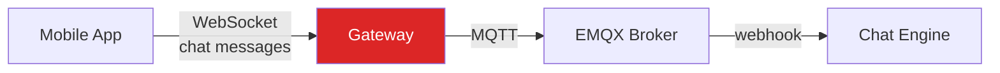
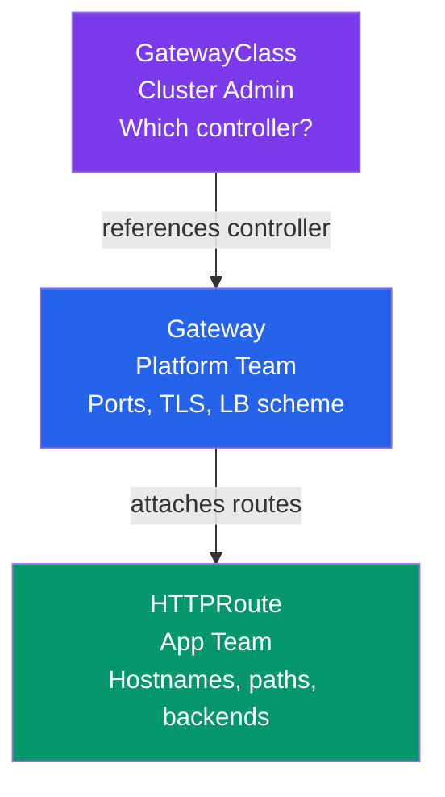
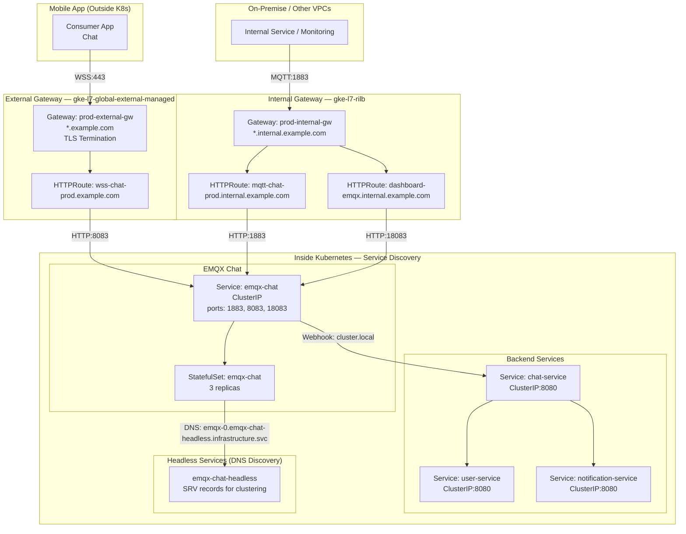
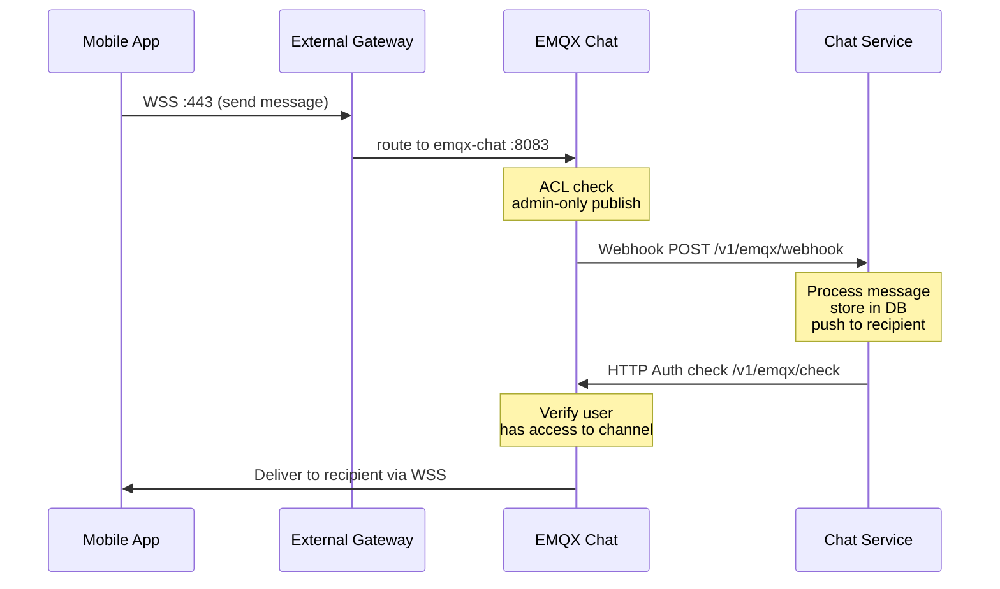
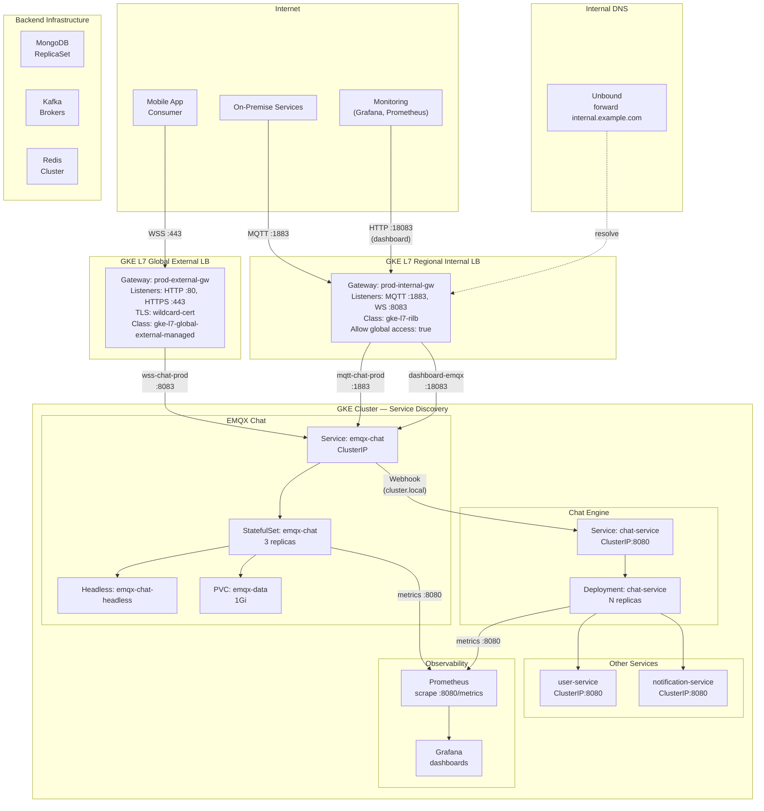

# Presentation Draft — KCD Indonesia 2026

> **Talk:** Architecting a Real-Time Chat Platform on GKE Using Kubernetes Gateway API and EMQX
> **Subtitle:** WebSocket chat at national scale
> **Format:** Lightning Talk (10 minutes)
> **Event:** Kubernetes Community Days Indonesia — October 24, 2026, Bandung
> **Status:** Accepted — preparation draft

---

## Slide 1 — Title (0:00 - 0:30)

**Architecting a Real-Time Chat Platform on GKE**
**Using Kubernetes Gateway API and EMQX**

WebSocket chat at national scale

Ahmad Nurhidayat — Platform Engineer, Consumer Platform

> **Speaker Notes:**
> Open with energy. This is a 10-minute lightning talk — no time for slow introductions.
>
> "Halo semua. Nama saya Ahmad, saya platform engineer di sebuah platform konsumen berskala nasional. Hari ini saya mau sharing bagaimana kami menjalankan real-time chat untuk jutaan user di Kubernetes — menggunakan Gateway API."
>
> Pause 2 detik sebelum lanjut. Biarkan judul tersimpan di slide.

---

## Slide 2 — The Problem (0:30 - 1:30)

**Platform kami punya jutaan user aktif. Setiap detik, pesan chat harus sampai.**

- Real-time in-app chat: user ↔ agent, user ↔ user
- Setiap client membuka koneksi WebSocket yang panjang
- Setiap pesan harus di-route ke broker yang benar dan user yang benar
- Authorization dilakukan per channel, bukan hanya saat connect

**Kalau WebSocket putus atau gateway salah config, chat degrade untuk semua user.**



> **Speaker Notes:**
> Ini bukan toy example. Ini production system.
>
> "Bayangkan — jutaan user membuka aplikasi dan membuka chat. Setiap client punya koneksi WebSocket yang hidup selama berjam-jam. Setiap pesan harus masuk ke broker yang benar, lolos authorization, lalu sampai ke penerima."
>
> "Tantangannya: kalau WebSocket connection mati, atau gateway salah config, chat degrade untuk semua user. Bukan satu user — semua user."
>
> Tunjukkan diagram sederhana: Mobile App -> Gateway -> EMQX -> Chat Engine.

---

## Slide 3 — Why Ingress Wasn't Enough (1:30 - 2:30)

**Ingress punya batasan untuk real-time chat:**

| Problem | Impact |
|---|---|
| WebSocket timeout | Connection mati setelah idle timeout default |
| Tidak ada weight-based routing | Canary deployment harus manual |
| ingress-nginx retired (March 2026) | Tidak ada security patches |
| Single resource owns everything | Platform team dan app team harus coordinate |

> **Speaker Notes:**
> Jangan terlalu lama di sini — audiens tahu masalah Ingress. Cukup highlight 2-3 poin.
>
> "Kami coba Ingress dulu. Tapi ada beberapa masalah. Pertama, WebSocket connections punya timeout. Kalau tidak di-tune, connection mati setelah beberapa menit idle. Kedua, tidak ada native canary deployment — harus pakai annotation hack. Ketiga, ingress-nginx sudah retired. Tidak ada security patches lagi."
>
> "Yang paling penting: Ingress adalah single resource yang menguasai semua — TLS, listeners, routing, backends. Platform team dan app team harus coordinate terus."

---

## Slide 4 — Gateway API: Role Separation (2:30 - 3:30)

**Gateway API memisahkan concerns:**



| Resource | Owner | Controls |
|---|---|---|
| GatewayClass | Cluster admin | Which controller |
| Gateway | Platform team | Ports, TLS, LB scheme, allowed namespaces |
| HTTPRoute | App team | Hostnames, paths, backends, weights |

> **Speaker Notes:**
> Ini poin terpenting dari talk ini.
>
> "Gateway API bukan hanya pengganti Ingress. Ini adalah role-oriented API. Setiap resource punya owner berbeda."
>
> "Cluster admin tentukan GatewayClass — controller mana yang dipakai. Platform team buat Gateway — ports, TLS certs, siapa yang boleh route. App team buat HTTPRoute — hostnames, paths, backends."
>
> "Di platform kami, ini memisahkan tugas. Platform team setup gateway sekali. App team bisa tambah route sendiri tanpa coordinate."

---

## Slide 5 — Dual-Gateway Architecture for Chat (3:30 - 5:00)

**Dua Gateway untuk tiga layer komunikasi**



### Three Communication Layers

| Layer | Gateway | Consumer | Protocol | DNS |
|---|---|---|---|---|
| **External** | `gke-l7-global-external-managed` | Mobile App | WSS :443 | `wss-chat-prod.example.com` |
| **Internal (cross-VPC)** | `gke-l7-rilb` | On-premise, other services, monitoring | MQTT :1883, HTTP :18083 | `mqtt-chat-prod.internal.example.com` |
| **Inside K8s** | None — Service Discovery | Pod-to-pod | ClusterIP / Headless | `emqx-chat.infrastructure.svc.cluster.local` |

### Key Insight

> **Mobile App** → External Gateway (WSS) → EMQX Chat
> **On-premise / cross-VPC** → Internal Gateway (MQTT) → EMQX Chat
> **Pod-to-pod inside K8s** → Service Discovery (ClusterIP/Headless) → Chat Engine

**External Gateway** — traffic publik, TLS termination, `*.example.com`
**Internal Gateway** — traffic internal dari luar cluster, `*.internal.example.com`
**Service Discovery** — komunikasi antar pod di dalam cluster, tanpa gateway

> **Speaker Notes:**
> Tunjukkan diagram ini. Biarkan audiens baca sebelum jelaskan.
>
> "Kami pakai tiga layer komunikasi. Pertama, External Gateway — user mobile app connect ke WebSocket lewat `wss-chat-prod.example.com`. Ini public internet, TLS termination di load balancer."
>
> "Kedua, Internal Gateway — service dari on-premise atau VPC lain butuh akses MQTT. Mereka connect ke `mqtt-chat-prod.internal.example.com`. Ini regional internal load balancer, tidak bisa diakses dari internet."
>
> "Ketiga, di dalam Kubernetes sendiri — pod-to-pod communication pakai service discovery. ClusterIP untuk services, headless untuk EMQX clustering. Tidak perlu lewat gateway."
>
> "Ini penting dipahami: Gateway API hanya untuk traffic yang MASUK atau KELUAR cluster. Traffic di dalam cluster pakai native Kubernetes service discovery."

---

## Slide 6 — Chat Message Flow: EMQX + Webhook (5:00 - 6:30)

**Chat: WebSocket → EMQX → Chat Engine via Webhook**



```yaml
# External HTTPRoute for chat
apiVersion: gateway.networking.k8s.io/v1
kind: HTTPRoute
metadata:
  name: chat-wss
  namespace: infrastructure
spec:
  parentRefs:
  - name: prod-external-gw
    namespace: gateway-api
    sectionName: https
  hostnames:
  - "wss-chat-prod.example.com"
  rules:
  - backendRefs:
    - name: emqx-chat
      port: 8083
```

**MQTT Topic Structure:**

| Topic | Purpose | Access |
|---|---|---|
| `channels/+/receive` | Channel messages | Admin publish, user subscribe |
| `users/+/receive` | Direct messages | Admin publish, user subscribe |
| `presence/#` | Online status | Client publish, scoped subscribe |

**Timeout alignment:**

| Layer | Setting | Why |
|---|---|---|
| Client | Heartbeat every 30–60s | Detect dead connections early |
| Gateway backend policy | 120s | Long-lived WebSocket |
| EMQX session TTL | 24 hours | Survive reconnects |
| Chat webhook | Measured and alerted | Slow webhook = slow delivery |

> **Speaker Notes:**
> "Chat memakai EMQX — MQTT broker yang di-expose via WebSocket. Gateway API route `wss-chat-prod.example.com` ke EMQX port 8083."
>
> "Yang menarik adalah authorization. User connect lewat webhook auth. Tapi itu hanya membuktikan siapa mereka. Apakah mereka boleh publish atau subscribe ke channel tertentu? Itu diputuskan oleh webhook ke chat service."
>
> "ACL-nya strict: admin-only publish, user hanya subscribe ke channel miliknya. Setiap pesan yang masuk diteruskan ke chat engine untuk diproses dan disimpan."
>
> "Dan satu hal yang sering dilupakan: timeout harus selaras. Client heartbeat, gateway timeout, dan session TTL broker harus saling cocok. Kalau tidak, chat putus di tengah jalan."

---

## Slide 7 — Key Takeaways (6:30 - 7:30)

**Apa yang kami pelajari:**

1. **Gateway API is role-oriented** — platform team owns Gateway, app team owns HTTPRoute
2. **WebSocket routing works, but timeouts must be explicit** — client heartbeat, backend policy, and broker session TTL must agree
3. **Separate gateways by trust boundary** — external for public WSS, internal for cross-VPC MQTT
4. **Canary is a route change** — weight and header matching, not parallel infrastructure
5. **Monitor connections and the webhook path** — handshake failures, broker saturation, and webhook latency

> **Speaker Notes:**
> Ringkas dan clear. Jangan baca satu per satu — cukup highlight poin 2-3.
>
> "Lima hal yang kami pelajari. Pertama, Gateway API bukan cuma pengganti Ingress — ini API yang memisahkan ownership antara platform team dan app team. Kedua, WebSocket routing langsung jalan, tapi timeout harus eksplisit di setiap layer — client, gateway, dan broker."
>
> "Ketiga, dua gateway dipisahkan oleh trust boundary, bukan cuma hostname. Keempat, canary deployment cukup lewat route change. Kelima, monitor connection health dan webhook latency — bukan hanya HTTP 5xx."

---

## Slide 8 — Full Production Architecture (7:30 - 8:30)



### Architecture Summary

| Component | Access Method | Protocol | Use Case |
|---|---|---|---|
| EMQX Chat | External Gateway | WSS :443 | Mobile chat clients |
| EMQX Chat | Internal Gateway | MQTT :1883 | On-premise / cross-VPC services |
| EMQX Chat | Internal Gateway | HTTP :18083 | Monitoring dashboard |
| Chat Engine | Service Discovery | ClusterIP :8080 | EMQX webhook processing |
| User / Notification | Service Discovery | ClusterIP | Chat supporting services |

> **Speaker Notes:**
> "Ini arsitektur production kami. Tiga layer komunikasi:"
>
> "External Gateway melayani mobile app — WSS untuk chat. Internal Gateway melayani on-premise dan monitoring — MQTT dan dashboard. Di dalam cluster, semua komunikasi pakai service discovery."
>
> "Perhatikan: EMQX berjalan sebagai StatefulSet 3 replicas dengan headless service untuk clustering via DNS SRV records. Chat engine terintegrasi via webhook — EMQX push pesan ke chat service lewat cluster-local service call. Tidak perlu lewat gateway."

---

## Slide 9 — CTA & Contact (8:30 - 9:15)

**Terima kasih!**

- Talk repository: [to be published]
- Gateway API: [gateway-api.sigs.k8s.io](https://gateway-api.sigs.k8s.io/)
- EMQX: [emqx.io](https://www.emqx.io/)

**Questions?**

Ahmad Nurhidayat
Platform Engineer @ Consumer Platform

> **Speaker Notes:**
> "Terima kasih. Kalau ada pertanyaan, silakan. Atau bisa DM saya setelah session."
>
> Jangan lupa sebut: "Slide ini tersedia di [link]. Dokumentasi lengkap akan dipublikasikan setelah acara."
>
> Tersenyum. Jangan lari dari stage. Biarkan MC yang tutup.

---

## Timing Summary

| Slide | Content | Time | Cumulative |
|---|---|---|---|
| 1 | Title | 0:30 | 0:30 |
| 2 | Problem | 1:00 | 1:30 |
| 3 | Why Ingress wasn't enough | 1:00 | 2:30 |
| 4 | Gateway API role separation | 1:00 | 3:30 |
| 5 | Dual gateway architecture | 1:30 | 5:00 |
| 6 | Chat flow and webhook | 1:30 | 6:30 |
| 7 | Key takeaways | 1:00 | 7:30 |
| 8 | Production architecture | 1:00 | 8:30 |
| 9 | CTA & contact | 0:45 | 9:15 |
| — | Buffer / transition | 0:45 | 10:00 |

---

## Speaker Tips

1. **Practice with timer** — 10 minutes is VERY short. Rehearse at least 5 times.
2. **Speak Indonesian** — KCD ID audience is Indonesian. Use English only for technical terms.
3. **Don't read slides** — audience can read. Talk about the "why" and "how".
4. **Show confidence** — you built this system. You know it better than anyone in the room.
5. **Engage the audience** — "Siapa di sini yang pakai Ingress-nginx?" then "Well, it's retired."
6. **Prepare for questions** — common questions:
   - "Why EMQX and not Kafka?" → MQTT is built for pub/sub with long-lived client connections; Kafka is a log, not a client-facing broker.
   - "Why not use a cloud load balancer directly?" → We still use GKE's managed LBs; Gateway API gives us portable, role-oriented routing on top.
   - "How many concurrent connections?" → millions; test your own broker and connection limits.
   - "How do you handle reconnects?" → client heartbeat, session TTL, and exponential backoff.
   - "What about message ordering?" → MQTT QoS and per-topic ordering; design for idempotent consumers.

---

## Slide Design Notes

| Slide | Visual Style |
|---|---|
| 1 | Dark background, platform logo + KCD |
| 2 | Simple diagram: App -> Gateway -> EMQX -> Chat Engine |
| 3 | Table with red highlights on problems |
| 4 | Vertical flow diagram: GatewayClass -> Gateway -> HTTPRoute |
| 5 | Two-column: External Gateway (left) + Internal Gateway (right) |
| 6 | Sequence diagram + code snippet + topic table |
| 7 | Numbered list with icons |
| 8 | Full architecture diagram (production) |
| 9 | Contact info + QR code to talk repo |

---

**Status:** Accepted — preparation draft
**Last updated:** October 2026
